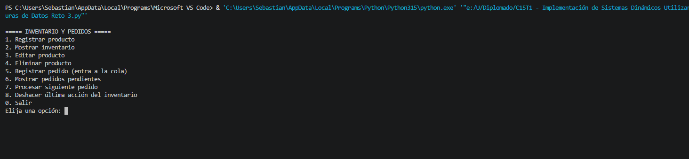
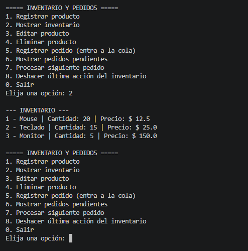
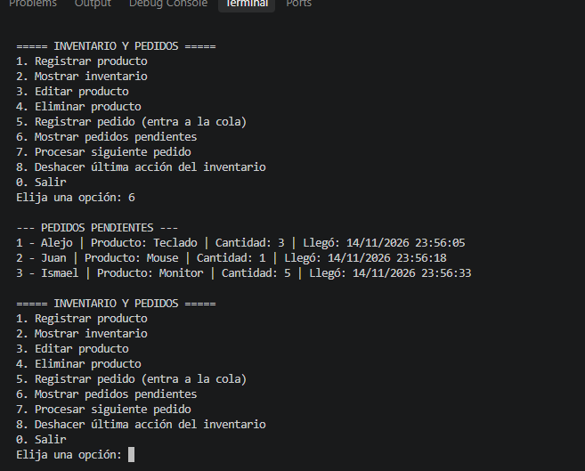
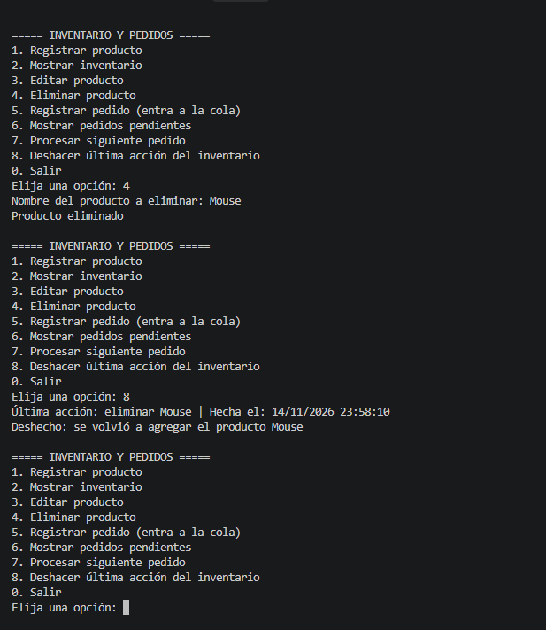

# Reto 3: Integración de estructuras de datos en el sistema de inventario y pedidos

## Descripción del programa

Este programa mejora el sistema de inventario y pedidos utilizando tres estructuras de datos: lista enlazada, cola y pila. Cada una se utiliza para realizar diferentes tareas y facilitar el manejo de los productos y pedidos.

## Instrucciones de ejecución

Para ejecutar el programa se necesita tener Python 3 instalado.

1. Abrir la carpeta donde se encuentra el archivo `integracion.py`.
2. Abrir una terminal en esa carpeta.
3. Escribir el siguiente comando:

```bash
python integracion.py
```

No es necesario compilar el programa ni instalar librerías adicionales, ya que utiliza `datetime`, que viene incluido en Python.

## Funcionalidades implementadas

El programa cuenta con las siguientes opciones:

1. **Registrar productos:** permite agregar nuevos productos al inventario.
2. **Mostrar inventario:** muestra los productos, sus cantidades y precios.
3. **Editar productos:** permite cambiar la cantidad y el precio de un producto.
4. **Eliminar productos:** permite quitar productos del inventario.
5. **Registrar pedidos:** permite guardar nuevos pedidos de los clientes.
6. **Mostrar pedidos:** muestra los pedidos que todavía están pendientes.
7. **Procesar pedidos:** atiende los pedidos en orden de llegada y verifica si existe suficiente stock.
8. **Deshacer acciones:** permite recuperar los cambios anteriores del inventario.

También se guarda la fecha y hora de los pedidos y de las acciones realizadas.

## Estructuras de datos utilizadas

### 1. Lista enlazada

Se utiliza para guardar los productos del inventario. Cada producto tiene su nombre, cantidad, precio y un enlace al siguiente producto.

**¿Por qué se utilizó?**

Porque permite agregar y eliminar productos sin tener que mover todos los demás elementos. Además, puede crecer según la cantidad de productos que se registren.

### 2. Cola (FIFO)

Se utiliza para guardar los pedidos pendientes. Los pedidos se procesan en el mismo orden en que fueron registrados.

**¿Por qué se utilizó?**

Porque en un sistema de pedidos es importante respetar el orden de llegada de los clientes. Así, el primer pedido registrado es el primero que se atiende.

### 3. Pila (LIFO)

Se utiliza para guardar las acciones realizadas en el inventario, como registrar, editar o eliminar productos.

**¿Por qué se utilizó?**

Porque permite deshacer los cambios empezando por el último que se realizó. De esta manera, si se modifica un producto por error, se pueden recuperar sus valores anteriores.

## Validaciones del programa

Para evitar errores, el programa también realiza algunas comprobaciones:

- No permite registrar dos productos con el mismo nombre.
- Avisa cuando un producto no existe.
- Comprueba que los valores ingresados sean números.
- Avisa cuando no hay pedidos pendientes.
- No permite procesar un pedido si no existe suficiente stock.
- Avisa cuando no hay acciones para deshacer.

## Conclusión

Con este reto pude aplicar tres estructuras de datos en un mismo sistema. Cada una tiene una función importante: la lista enlazada organiza el inventario, la cola permite atender los pedidos por orden de llegada y la pila permite deshacer los últimos cambios. De esta manera, el programa queda más organizado y permite manejar mejor los productos y pedidos.

## Ejemplo de ejecución

Sesión de ejemplo (editar y deshacer, y la cola de pedidos):

```
Nombre del producto a editar: Cable
Valores actuales -> Cantidad: 30 | Precio: $ 3.5
Nueva cantidad en stock: 25
Nuevo precio: 4
Producto actualizado

Última acción: editar Cable | Hecha el: 15/11/2026 03:59:02
Deshecho: se restauraron los valores de Cable

--- PEDIDOS PENDIENTES ---
1 - Ana | Producto: Mouse | Cantidad: 5 | Llegó: 15/11/2026 03:59:02
2 - Luis | Producto: Monitor | Cantidad: 10 | Llegó: 15/11/2026 03:59:02

Pedido de Ana atendido. Total a pagar: $ 62.5
Pedido de Luis rechazado: solo hay 5 unidades de Monitor
No hay pedidos para procesar
```

### Capturas de pantalla

**Menú principal**



**Inventario (lista enlazada)**



**Pedidos pendientes y procesamiento (cola)**



**Deshacer una acción (pila)**


